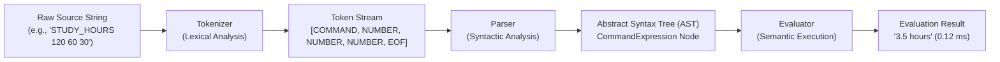

# CSCI 310 Mini-Interpreter Technical Specification
## Architecture, Grammar, and Evaluation Engine

> **Course:** CSCI 310 Principles of Programming Languages  
> **Institution:** Amity University Dubai, EAID  
> **Assignment Component:** Task 5: Develop a Mini-Interpreter (4 Marks)  
> **Course Learning Outcome:** CLO5 – Generate program interpreters for a given program code.

---

## 1. Introduction & Design Goals

The StudyFlow Mini-Interpreter is a custom domain-specific expression evaluator engineered specifically for academic workflow computations. It allows students to calculate mathematical operations, analyze study times, determine assignment progress percentages, and evaluate grading eligibility criteria through a clean textual interface.

### Strict Safety Constraint
As mandated by course requirements and secure coding practices:
> **Zero Dynamic Code Execution:** The interpreter **does not use** JavaScript `eval()`, `new Function()`, `setTimeout(string)`, or any external parser libraries. The lexical analyzer, recursive-descent parser, and AST evaluator are handcrafted in TypeScript using Object-Oriented principles.

---

## 2. Formal Language Grammar (EBNF)

The language supports both **prefix command syntax** (e.g., `ADD 10 20`) and **functional parenthesized syntax with optional commas** (e.g., `AVERAGE(80, 70, 90)` or `PASS(65)`).

```ebnf
Expression         ::= CommandInvocation
CommandInvocation  ::= COMMAND [ "(" ] ArgumentList [ ")" ]
ArgumentList       ::= Argument { [ "," ] Argument }
Argument           ::= NUMBER | BOOLEAN | STRING | CommandInvocation

COMMAND            ::= "ADD" | "SUB" | "MUL" | "DIV" | "STUDY_HOURS" 
                     | "PROGRESS" | "AVERAGE" | "PASS" | "ELIGIBLE" 
                     | "SUM" | "HELP"

NUMBER             ::= [ "-" | "+" ] DIGIT { DIGIT } [ "." DIGIT { DIGIT } ]
BOOLEAN            ::= "TRUE" | "FALSE"
STRING             ::= '"' { CHARACTER } '"' | "'" { CHARACTER } "'" | IDENTIFIER
DIGIT              ::= "0" | "1" | ... | "9"
```

---

## 3. Interpreter Pipeline Architecture

The interpreter processes input text through three sequential stages encapsulated in distinct OOP classes:



---

## 4. Stage 1: Lexical Analysis (`Tokenizer`)

The `Tokenizer` class ([src/core/Interpreter.ts](file:///C:/Users/ss/OneDrive/Desktop/PPl%20project/src/core/Interpreter.ts)) scans the source string character-by-character using an internal cursor:

1. **Whitespace Elimination:** Strips leading, trailing, and inter-token spaces, tabs, and newlines.
2. **Punctuation Recognition:** Identifies structural delimiter characters `(`, `)`, and `,`.
3. **Numeric Literals:** Handles positive and negative integers and floating-point decimals (e.g., `120`, `-15`, `3.14`).
4. **Identifier & Keyword Disambiguation:** Reads alphanumeric tokens and compares them against reserved command names (`ADD`, `AVERAGE`, etc.) and boolean literals (`TRUE`, `FALSE`).
5. **String Scanning:** Reads single- or double-quoted strings with unterminated string validation.
6. **Error Detection:** If an unknown character is encountered (e.g., `@`, `#`, `$`), a `LexicalError` is thrown containing the exact character offset.

### Example Tokenization Output
For input: `AVERAGE(80, 70, 90)`
```json
[
  { "type": "COMMAND", "value": "AVERAGE", "position": 0 },
  { "type": "LPAREN", "value": "(", "position": 7 },
  { "type": "NUMBER", "value": "80", "position": 8 },
  { "type": "COMMA", "value": ",", "position": 10 },
  { "type": "NUMBER", "value": "70", "position": 12 },
  { "type": "COMMA", "value": ",", "position": 14 },
  { "type": "NUMBER", "value": "90", "position": 16 },
  { "type": "RPAREN", "value": ")", "position": 18 },
  { "type": "EOF", "value": "<EOF>", "position": 19 }
]
```

---

## 5. Stage 2: Syntactic Analysis (`Parser`)

The `Parser` class consumes the linear token stream produced by the `Tokenizer` and constructs an **Abstract Syntax Tree (AST)**:

1. **Root Verification:** Verifies that the initial token is a valid recognized `COMMAND`. If not, it raises a descriptive `SyntaxError` suggesting valid commands.
2. **Parentheses Matching:** If an opening `LPAREN` is detected, the parser enters bracketed mode and verifies that a matching `RPAREN` terminates the argument list.
3. **Argument Parsing:** Recursively processes arguments, converting `NUMBER` tokens into numeric AST nodes, `BOOLEAN` into boolean nodes, and nested commands into sub-trees.
4. **Comma Tolerance:** Gracefully ignores optional commas between arguments to support both standard comma-separated syntax and space-separated CLI syntax.

### Example AST Output
For input: `STUDY_HOURS 120 60 30`
```json
{
  "type": "CommandExpression",
  "command": "STUDY_HOURS",
  "args": [
    { "type": "NumberLiteral", "value": 120, "position": 12 },
    { "type": "NumberLiteral", "value": 60, "position": 16 },
    { "type": "NumberLiteral", "value": 30, "position": 19 }
  ],
  "position": 0
}
```

---

## 6. Stage 3: Semantic Evaluation (`Evaluator`)

The `Evaluator` class traverses the AST and executes the corresponding domain logic:

### Supported Command Implementations

#### 1. Basic Arithmetic
- `ADD a b`: Evaluates $a + b$. Requires exactly 2 numbers.
  - Example: `ADD 10 20` $\to$ `30`
- `SUB a b`: Evaluates $a - b$. Requires exactly 2 numbers.
  - Example: `SUB 20 5` $\to$ `15`
- `MUL a b`: Evaluates $a \times b$. Requires exactly 2 numbers.
  - Example: `MUL 4 5` $\to$ `20`
- `DIV a b`: Evaluates $a / b$. Requires exactly 2 numbers.
  - **Division by Zero Protection:** If $b = 0$, explicitly throws `RuntimeError: Division by zero error: The denominator cannot be 0.`
  - Example: `DIV 20 4` $\to$ `5`
- `SUM n1 n2 ...`: Evaluates $\sum n_i$ for variable argument counts.
  - Example: `SUM 10 20 30` $\to$ `60`

#### 2. Academic Study Metrics
- `STUDY_HOURS m1 m2 ...`: Converts minute intervals into cumulative hours:
  $$\text{Hours} = \frac{\sum m_i}{60}$$
  - Example: `STUDY_HOURS 120 60 30` $\to$ `3.5 hours`
- `PROGRESS completed total`: Calculates percentage completion ratio:
  $$\text{Percentage} = \text{round}\left(\frac{\text{completed}}{\text{total}} \times 100\right)\%$$
  - Guards against negative inputs and division by zero.
  - Example: `PROGRESS 8 10` $\to$ `80%`

#### 3. Grading & Academic Eligibility Logic
- `AVERAGE n1 n2 ...`: Computes arithmetic mean of grades:
  $$\text{Mean} = \frac{\sum n_i}{N}$$
  - Example: `AVERAGE(80, 70, 90)` $\to$ `80`
- `PASS score [threshold=50]`: Returns boolean evaluation based on cutoff:
  $$\text{Result} = \text{score} \ge \text{threshold}$$
  - Example: `PASS(65)` $\to$ `True`; `PASS 45 50` $\to$ `False`
- `ELIGIBLE attendance status`: Evaluates university exam admission rule:
  $$\text{Eligible} = (\text{attendance} \ge 40) \land \text{status}$$
  - Example: `ELIGIBLE(45, TRUE)` $\to$ `True`; `ELIGIBLE 35 TRUE` $\to$ `False`

---

## 7. Error Handling & Diagnostics

The interpreter provides rich diagnostics without crashing:

| Error Type | Trigger Condition | Diagnostic Message Example |
| :--- | :--- | :--- |
| **LexicalError** | Unknown character encountered | `[Lexical Error at pos 7]: Unexpected character '$'` |
| **SyntaxError** | Empty input or unknown command | `Expected a valid command at start, but received "CALC"` |
| **SyntaxError** | Unbalanced parenthesis | `Missing closing parenthesis ')' for command AVERAGE` |
| **RuntimeError** | Arity mismatch | `ADD requires exactly 2 numeric arguments. Received: 1.` |
| **RuntimeError** | Division by zero | `Division by zero error: The denominator cannot be 0.` |
| **RuntimeError** | Type violation | `Argument 2 for PROGRESS must be a number, received: "abc"` |

---

## 8. Performance Telemetry

The top-level `Interpreter.execute()` method wraps the pipeline in high-resolution browser timers (`performance.now()`). The execution time (typically between **0.05 ms and 0.45 ms**) is returned alongside the AST and token stream, allowing real-time inspection in the StudyFlow UI.
